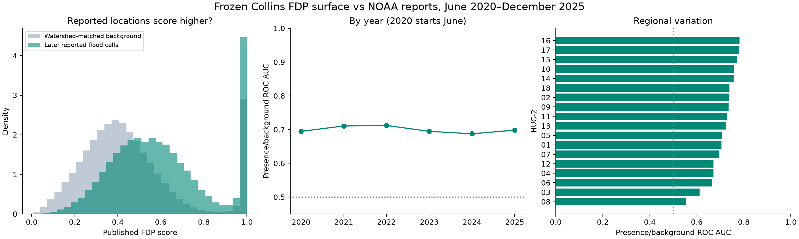

# Local temporal validation: June 2020–December 2025

Start with the executed [notebook](validation.ipynb) or its
[HTML version](validation.html). This file is the detailed run record.

Run date: 2026-10-15. The frozen Collins FDP surface retains a moderate ability
to rank later NOAA report locations above watershed-matched background. It is
less discriminating for flash floods and in several southeastern watersheds.
These results justify a controlled retraining pilot, but do not establish
calibrated damage probabilities or reproduce the paper's evaluation.

## Results

| Evaluation                                 | Unique 100 m report cells | ROC AUC | Approximate 95% interval |
| ------------------------------------------ | ------------------------: | ------: | ------------------------ |
| All Flood / Flash Flood reports            |                    32,091 |   0.696 | 0.689–0.703              |
| Reports with recorded damage or casualties |                     8,642 |   0.683 | 0.674–0.692              |

Recorded impact means positive property/crop damage or at least one recorded
injury/death. Missing monetary estimates are not treated as known zeros. The
all-report cohort can include flooding without recorded damage; the impact
cohort omits unquantified disruptions and narrative-only impacts. Neither is
claimed to reproduce the original paper's exact inclusion rule.

Against uniformly sampled eligible area within each watershed, the highest
scoring 10% captures an estimated **24.0%** of all report cells, and the highest
scoring 20% captures **45.0%**. For recorded-impact cells the corresponding
figures are **22.8%** and **42.6%**. Threshold ties are allocated fractionally,
equivalent to expected capture with uniform random tie-breaking. This matters
because some watersheds contain large areas tied at score 1.0.



Additional checks:

- Weighting each event rather than each unique cell gives AUC **0.703**.
- New cells absent from reconstructed historical begin-point reports:
  **30,362 cells**, AUC **0.688**. Repeated historical cells: **1,729 cells**,
  AUC **0.829**. Historical overlap is approximate, not membership in the
  unavailable released training sample.
- Using NOAA's separate location table instead of begin coordinates gives
  **102,888 unique cells**, AUC **0.683**; restricting those locations to events
  with recorded impacts gives **26,780 cells**, AUC **0.669**. Multiple locations
  of an event are not independent damage observations.
- Equal-weight mean of the 18 HUC-specific AUCs: **0.711**. This differs from
  the pooled, report-distribution-weighted AUC above.
- For all reports, Flood AUC is **0.740**, versus **0.677** for Flash Flood.
- All-report yearly AUCs range from **0.687 to 0.712** (2020 starts June).
  They show no clear monotonic deterioration over this period; this is a
  descriptive observation, not a formal trend test.
- All-report regional weaknesses include Lower Mississippi (HUC 08):
  **0.554**, and South Atlantic-Gulf (HUC 03): **0.612**. Regional sample sizes
  differ substantially; see the group table before comparing regions.

## Sample and exclusions

| Step                                                    | Event rows |
| ------------------------------------------------------- | ---------: |
| NOAA Flood / Flash Flood, June 2020–December 2025       |     36,654 |
| Exclude Alaska, Hawaii and territories                  |     35,095 |
| Exclude 468 begin locations without valid raster values |     34,627 |
| Of retained events, recorded damage/casualties          |      8,887 |

All retained begin points had usable coordinates and unambiguous HUC assignment.
Deduplicating their native raster cell IDs yields 32,091 positive cells.
Background consists of **227,020 unique valid raster cells**, uniformly sampled
within the current HUC-2 regions. Known report cells are excluded: historical
and test-period begin points, plus test-period location-table points. Some
unobserved or unreported flood locations will still be in the background.

The reconstructed December 2006–May 2020 begin-point inventory contains
71,526 valid unique cells. Its proximity to the paper's 71,434 locations does
not establish equivalence: NOAA revisions, original selection rules and
original boundary processing remain unresolved.

## Method and interpretation

- Sample the project's archived USGS source TIFF at native 100 m resolution
  in EPSG:5070. A check of 12 report cells against served Zarr level 0 matched
  exactly; source hashes are in the manifest.
- Use begin coordinates for the primary evaluation. Join the location table
  to event details by `EVENT_ID` for the sensitivity analysis, retaining
  `LOCATION_INDEX`. Event damage amounts are used only for filtering, never
  summed across multiple location rows.
- Retain one positive per native cell for the pooled primary evaluation, and
  one per cell within each year/event-type subgroup. Yearly counts therefore
  need not sum to the pooled unique count.
- Use current USGS HUC-2 boundaries, simplified by the service to 100 m.
  Exclude ambiguous overlap strips rather than duplicating samples.
- Reweight background to match each evaluation cohort's HUC distribution,
  with equal total weight for positives and background. Average precision
  in the JSON is for this artificial 50:50 class balance, not population
  precision. Per-HUC AUC uses only that HUC's background.
- Estimate intervals with 200 Poisson bootstrap replicates of 50 km spatial
  blocks, applying shared block weights to positives and background. Intervals
  are conditional on the reporting process, chosen background sample and
  method. They do not capture all storm-scale dependence or methodological
  uncertainty. Only one background-generation seed was used.

**The key limitation is the comparison population.** This run does not match
land cover or exclude floodplain cells as the original paper did. The original
USGS response/predictor archive downloads could not be retrieved publicly in
this session, and the supplementary selection rules were not recovered.
Consequently, this run evaluates presence/background ranking, with exposure
and reporting biases still present. AUC 0.696 must not be interpreted as a
decline from the paper's reported 0.750, since the evaluation designs differ.
It also does not validate annual probabilities, loss amounts or individual
building risk. Building footprints were not used in the evaluation.

The broad temporal evaluation has now inspected 2024–2025. Those years can
still support a transparent retrospective model comparison, but are no longer
an untouched confirmatory holdout for choices informed by these findings.

## Reproduce and inspect

From the repository root, using the script's declared dependencies:

```bash
uv run input-data/tensor/fdp/validate_fdp.py --output _build/fdp-validation/2026-10-15
```

Alternatively, run it with an existing Python environment containing those
packages. This session used the existing OCR default Pixi environment; exact
installed package versions and the executed script hash are in the manifest.
The minimal `fdp` packaging environment alone does not contain all dependencies.

Inputs cache under `~/.cache/ocr/fdp-validation`. The downloaded NOAA directory
index is frozen in the cache; each data file's publication date appears in its
filename. Reusing the cache preserves this input snapshot. Use a new cache
directory to resolve a newer NOAA snapshot. Raw data are not committed.

- [Metrics](metrics.json), [metrics by year/HUC/event type](metrics_by_group.csv),
  [input hashes and environment](manifest.json).
- [Begin-point QA counts](qa_begin_counts.csv) include historical and test years;
  the 2020 row covers both parts of that calendar year. The test-only exclusions
  are stated above. [Location-table QA counts](qa_location_counts.csv) cover only
  the test period.
- Full local Parquet artifacts: `_build/fdp-validation/2026-10-15/`, including
  scored begin reports, unique cells, all location reports, background and
  excluded begin reports. That directory is git-ignored.
- Six small correctness tests cover money parsing, raster edges, nodata,
  overlapping HUC boundaries, watershed weighting and score ties. Run with
  `python -m unittest discover -s input-data/tensor/fdp -p test_validate_fdp.py`.

The completed cached-input run took **43 seconds wall time**, with approximately
**11.3 GB peak memory footprint** (10.2 GB maximum resident set). The initial
3.17 GB TIFF download took about 6.2 minutes. No cloud compute was launched and
no remote objects were modified; existing S3 read/egress charges may still
apply. This is a validation benchmark, not a retraining benchmark.

## Implication for the rerun

This evaluation tested only the frozen published model. It identifies useful
signal and weaknesses, but does not demonstrate that adding newer reports will
improve predictions. That requires comparing an original-period refit and an
extended-period refit with the same predictors, modeling procedure and later
evaluation period excluded from both training sets.

Keep the frozen map as a baseline. Before claiming gains from retraining,
recover the original sampling inputs/rules and add an exposure-controlled
background comparison. Prioritize HUC 03 and HUC 08 when inspecting failures
and selecting pilots. Preserve these scores and this protocol so changes in
the evaluation population are not confused with model improvement.

Sources: [NOAA bulk files](https://www.ncei.noaa.gov/pub/data/swdi/stormevents/csvfiles/),
[NOAA field documentation](https://www.ncei.noaa.gov/pub/data/swdi/stormevents/csvfiles/Storm-Data-Bulk-csv-Format.pdf),
[USGS HUC-2 service](https://hydro.nationalmap.gov/arcgis/rest/services/wbd/MapServer/1),
[Collins data release](https://doi.org/10.5066/P954TTQN).
